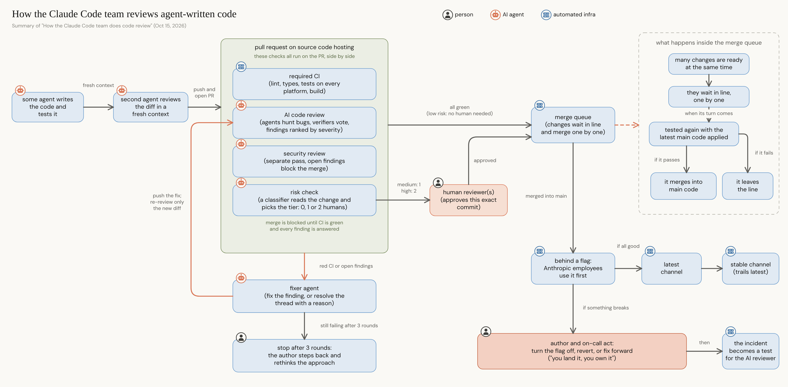

# Claude Code review flow

A one-page diagram of how the Claude Code team reviews agent-written code, from the agent's own verification through PR checks, risk-based human approval, the merge queue, staged rollout, and recovery.

## Legend

- **Person**: a human decides or acts (reviewers, the author, on-call)
- **AI agent**: Claude does the work (writing, reviewing, fixing, risk classification)
- **Automated infra**: CI, the merge queue, flags and release channels, the incident eval

Orange arrows show the fix loop: findings go to a fixer agent, the fix is pushed, and only the new diff is re-reviewed. After 3 rounds the author steps back and rethinks the approach.

## Source

This diagram summarizes the following article. All process details come from it; any errors in the summary are ours.

> Addy Osmani, Morgan Westlee Lunt, and Qing Wang. "How the Claude Code team does code review." Anthropic, claude.dev, October 15, 2026.

This is an unofficial summary and is not affiliated with or endorsed by Anthropic.

## Files

- `code-review-flow-4k.png`: 3840 × 1891 image
- `code-review-flow.excalidraw`: editable source (open at https://excalidraw.com)
